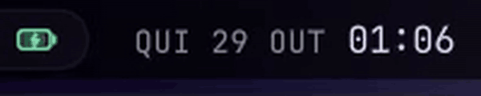
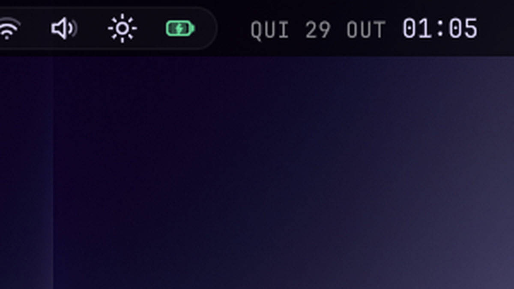
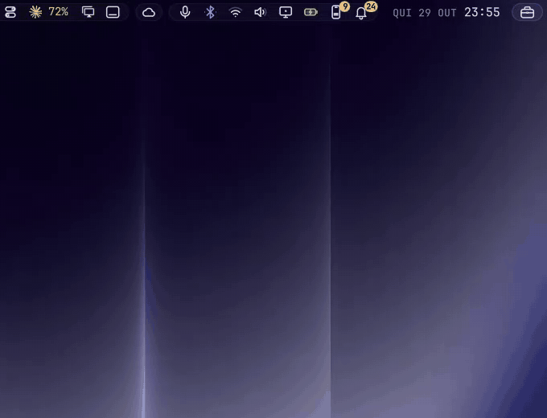

<div align="center">

# Island Clock

**A clock that ticks over instead of blinking.**
Quiet date, bright time, and every minute flips in.



</div>



## Why this one

- 🔁 **Minutes that flip.** When the minute changes the old time lifts away and
  the new one rises in on a smooth ease-out curve, instead of the text just swapping.
- 🎚️ **Two-tone, monospaced.** The date sits small, upper case and muted
  (`THU 29 OCT`); the time stays bright. Digits never shift sideways.
- 🌍 **Your language.** Day and month names follow the system locale, without the
  trailing dots some locales add (`qui.` → `QUI`).
- 📅 **Omarchy's full calendar panel, in the Island look**, on click: month view with week numbers,
  week-start toggle and the life-progress bar. Right-click cycles the label
  formats. It is the official clock underneath.
- 🔄 **Drop-in replacement** for the built-in clock: enabling it swaps Omarchy's
  clock out of the bar; disabling it puts the original back.

## See it

Recorded on a real desktop, mouse and clicks included; this take is in Portuguese.

**The calendar** (with [Island Kit](https://github.com/hugorolimf/omarchy-island-kit)): a
click on the clock opens it, with the year's progress and week numbers; the arrows walk
through the months.



## Install

```bash
omarchy plugin add https://github.com/hugorolimf/omarchy-island-kit --enable
omarchy plugin add https://github.com/hugorolimf/omarchy-clock --enable
```

The calendar panel is drawn with [Island Kit](https://github.com/hugorolimf/omarchy-island-kit) (install it first, or install the clock from the Kit's catalog).

Works with Omarchy's own bar and with [Island Bar](https://github.com/hugorolimf/omarchy-bar).

## Requirements

- Omarchy with the Quattro shell (Quickshell).
- [Island Kit](https://github.com/hugorolimf/omarchy-island-kit): the calendar panel is drawn with it.
  Without it, the plugin shows an "Install Island Kit" button on the bar (in
  Portuguese, "Instale o Island Kit"); clicking it installs the Kit and restarts
  the shell.
- The JetBrainsMono Nerd Font that Omarchy ships.

It writes no files of its own; formats and week start are kept where Omarchy's
clock keeps them.

## Remove

```bash
omarchy plugin remove io.github.hugorolimf.clock
```

Omarchy's built-in clock comes back to the bar.

## Credits

Built on Omarchy's own `omarchy.clock` widget by David Heinemeier Hansson and the
[Omarchy](https://github.com/basecamp/omarchy) contributors (MIT). The calendar,
formats and IPC are theirs; the look, the flip animation and the localisation are
this plugin's.

## Pairs well with

[Glass Dock](https://github.com/hugorolimf/omarchy-dock) ·
[Glass Alt+Tab](https://github.com/hugorolimf/omarchy-alttab) ·
[Island Notch](https://github.com/hugorolimf/omarchy-island-notch)

## License

[MIT](LICENSE)
